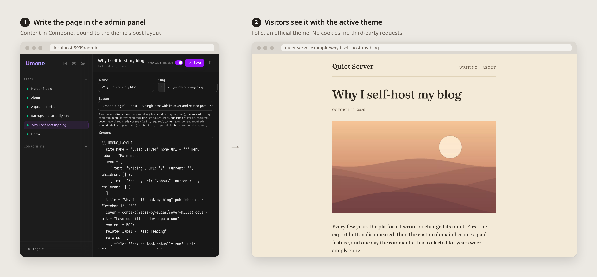
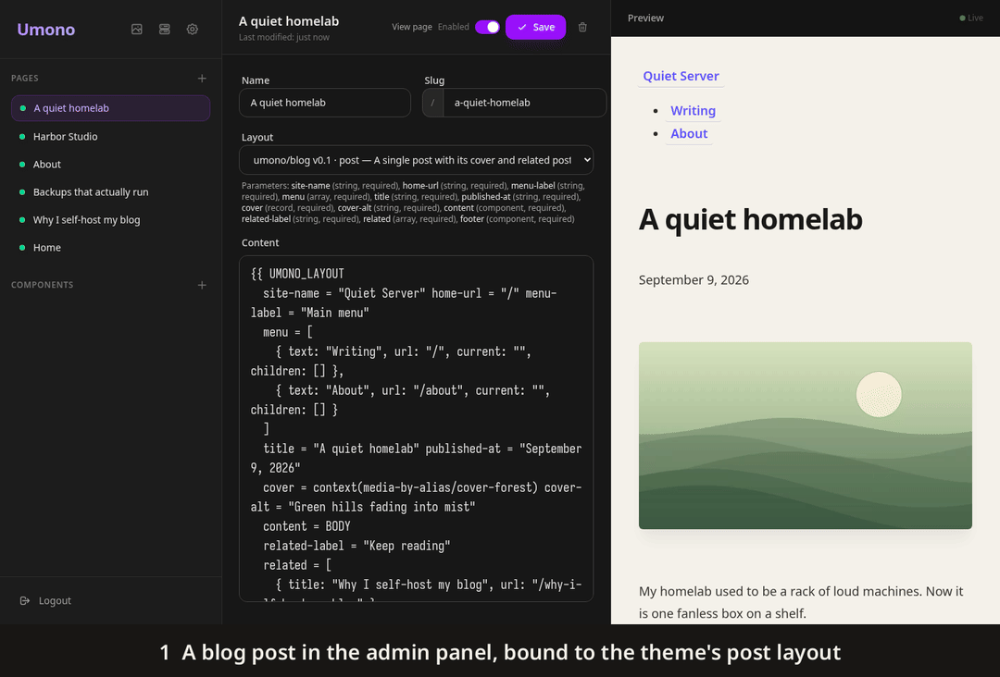

# Umono
**Umono** is a self-hosted CMS that keeps your content apart from the theme that styles it.



## What it is
- One Go binary and a SQLite file.
- Runs on Linux and macOS, x86_64 and arm64.
- The [CLI](https://github.com/umono-cms/cli) installs Umono, sets up a site and upgrades it later.
- Pages are written in [Compono](https://github.com/umono-cms/compono), a Markdown-based language with components. The admin panel previews the page as you type.
- Themes are only CSS, fonts and images. A theme styles a published page structure, called a contract, and can't change what a page says. The official themes are [Octavo](https://github.com/umono-cms/theme-octavo) for simple sites and [Folio](https://github.com/umono-cms/theme-folio) for blogs.
- Public pages set no cookies and make no third-party requests.



## Status
Umono is not finished, and development is ongoing. Compono is better suited to technical users today, and there is no plugin system yet.

## How it's built
The code is written by AI agents, Claude Code and opencode. Development is document-first: decisions and specs are written before the code, every change is reviewed against its spec, and the behavior is pinned by tests.

## Install
```sh
curl -fsSL https://umono.io/install.sh | sh
```

## Usage
Use the CLI to create a new project and Up

```
umono create my-website
cd my-website
umono up
```

👉 http://127.0.0.1:8999/admin

[Your first site](https://docs.umono.dev/getting-started/your-first-site/) walks you from an empty directory to a site with a theme.

## Feedback
Tried Umono? Tell us where you got stuck or what you'd need in [GitHub Discussions](https://github.com/umono-cms/umono/discussions).

## Development
### TailwindCSS Installation
TailwindCSS is used for the admin UI and must be installed locally.
```bash
mkdir -p bin
curl -sLO https://github.com/tailwindlabs/tailwindcss/releases/download/v4.1.18/tailwindcss-linux-x64
mv tailwindcss-linux-x64 bin/tailwindcss
chmod +x bin/tailwindcss
```

### Live Reload
Umono uses **air** for live reload.

Runs on **port 9000**:
```
air
```

### Theme Development Mode
`umono theme dev` of the [CLI](https://github.com/umono-cms/cli) starts Umono with `UMONO_THEME_DEV`, the absolute path of the theme project. Only then does `themes/dev/dev/0.0.0/` get the privileges of `dev/dev`. A value that is empty, relative or not a directory stops Umono at startup.

In dev mode:
- `dev/dev` is the active theme of its contract group and is not written to `active_themes`. Its group cannot be activated, deactivated or retried.
- Its contract record is added from `contract.toml` at startup without asking umono.dev. Its `assets/`, `attributes.toml` and `contract.toml` may be symlinks into the theme project, and only there.
- It is checked on every request. `/_theme/dev/theme.css` is the canonical CSS of `assets/theme.css`, a CSS error is a 500, and every response under `/_theme/dev/` is `no-store`. A page whose check fails renders with the fallback.
- The theme management page shows it as the theme in development.

The e2e tests run a second instance in dev mode.

### End-to-End Tests
The admin UI is tested in a headless Chromium with [playwright-go](https://github.com/mxschmitt/playwright-go). The tests are in `e2e/` and carry the `e2e` build tag, so `go test ./...` runs without a browser.

Install Chromium once, with the playwright-go version in `go.mod`:
```bash
go run github.com/mxschmitt/playwright-go/cmd/playwright install --with-deps chromium
```

Generate the stylesheet, then run the tests:
```bash
./bin/tailwindcss -i assets/input.css -o public/css/style.css
go test -tags e2e ./e2e/
```

The tests build `./cmd/umono` and start it in a temporary directory with its own `.env`, database and uploads, so your `umono.db`, `uploads/` and `.env` are not touched. Without `style.css` every test fails on its 404.

Set `E2E_ARTIFACTS` to a directory to keep a Playwright trace and a screenshot of each failing test. Open a trace with `go run github.com/mxschmitt/playwright-go/cmd/playwright show-trace <file>`. CI uploads them as the `e2e-artifacts` artifact.

### Contributing
Umono is a small, opinionated project built on the idea of simplicity and clear separation of concerns. I genuinely appreciate any help—whether it's fixing a simple typo, improving the documentation, or tackling a bug.

If you are looking for a place to start, feel free to check out the issues labeled `good first issue`. For larger changes or new features, please open an issue first so we can chat about it before you write any code.

Please take a look at our [CONTRIBUTING.md](CONTRIBUTING.md) for a quick overview of the project's philosophy and workflow.
